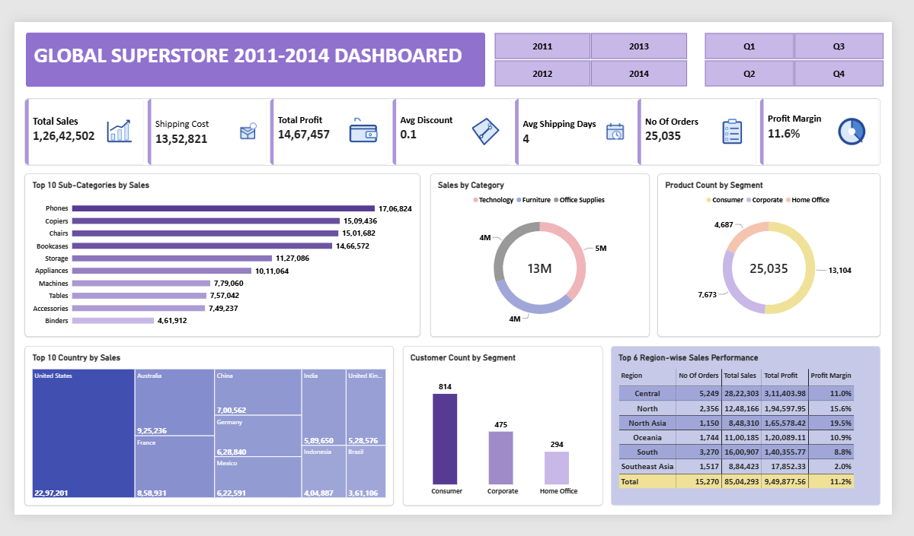
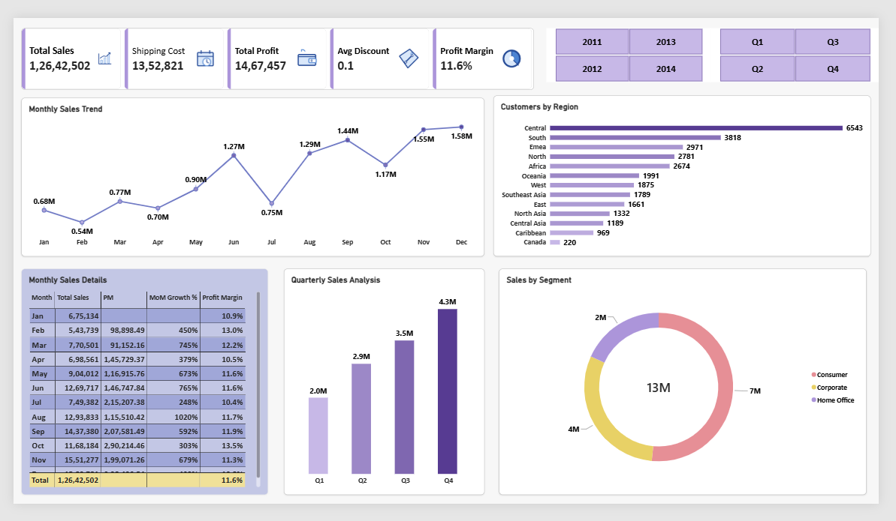

# 🌍 Global Superstore Sales Analytics Dashboard

## 📌 Project Overview

This project presents an interactive **Global Superstore Sales Analytics Dashboard** built using Microsoft Power BI.

The dashboard analyzes sales and business performance from **2011 to 2014**, providing insights into sales, profitability, shipping costs, customer segments, product categories, and regional performance.

It consists of two dashboard pages that help understand business trends, identify top-performing products and regions, and monitor sales performance over time.

## 📊 Dashboard Features

**Page 1 – Sales & Business Performance**
- Top 10 Sub-Categories by Sales
- Sales by Product Category
- Product Count by Customer Segment
- Top 10 Countries by Sales
- Customer Count by Segment
- Region-wise Sales Performance
- Year and Quarter Filters

**Page 2 – Sales & Customer Analysis**
- Monthly Sales Trend
- Customers by Region
- Monthly Sales Details
- Quarterly Sales Analysis
- Sales by Customer Segment
- Year and Quarter Filters

## 📈 Key KPIs

| KPI | Value |
|---|---:|
| Total Sales | 1,26,42,502 |
| Total Profit | 14,67,457 |
| Shipping Cost | 13,52,821 |
| Average Discount | 0.1 |
| Average Shipping Days | 4 |
| Number of Orders | 25,035 |
| Profit Margin | 11.6% |

## 🛠️ Tools & Technologies

- **Microsoft Power BI** – Dashboard development and data visualization
- **CSV Dataset** – Global Superstore sales data
- **GitHub** – Project documentation and portfolio hosting

## 🖼️ Screenshot

### Dashboard Overview

### Sales & Customer Analysis

## 💡 Business Insights

- **Top Sub-Category:** Phones generated the highest sales among the displayed top 10 sub-categories.
- **Top Country:** The United States recorded the highest sales among the displayed countries.
- **Customer Segment:** Consumer customers represent the largest segment in both customer count and product count.
- **Monthly Performance:** December recorded the highest monthly sales at approximately 1.58M, while February recorded the lowest at approximately 0.54M.
- **Quarterly Performance:** Q4 achieved the highest quarterly sales at approximately 4.3M.
- **Regional Performance:** Central recorded the highest total sales among the six regions shown in the regional performance table.
- **Profitability:** North Asia recorded the highest profit margin at 19.5% among the six regions displayed in the table.

## 👨‍💻 Author

**Subhakar**

Aspiring Data Analyst | Power BI | Data Analytics

Interested in transforming raw data into meaningful business insights through data analysis and visualization.
